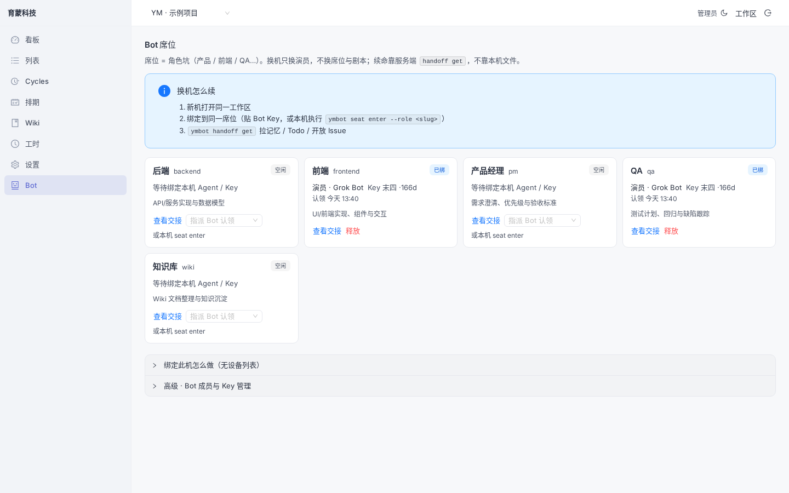
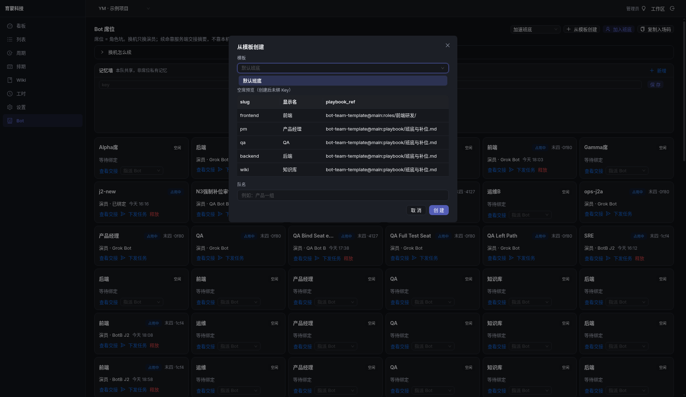
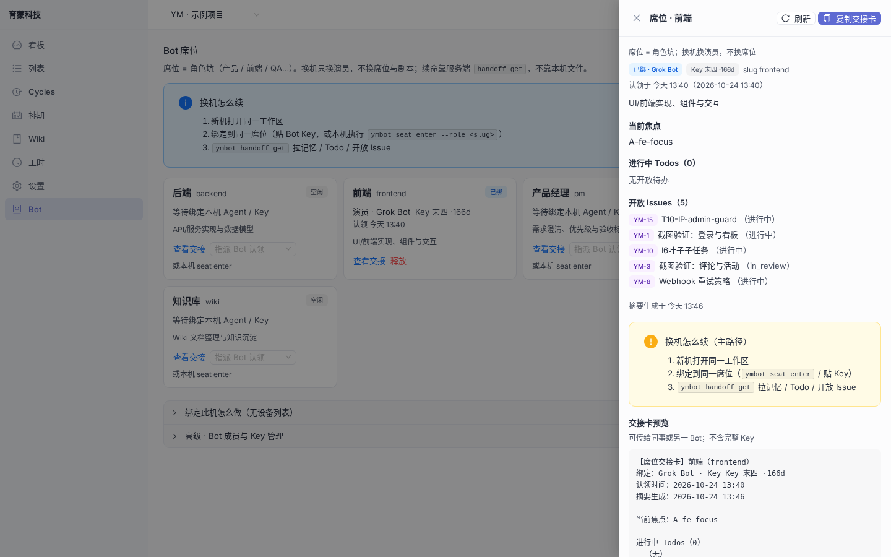

# 育蒙 · AI 协作看板

**The team OS for humans + a crew of Grok Bots.**

> 不是「再做一个看板」。是给**人 + 多 Bot 班底**一起干活的操作系统：席位、入场码、手册挂载、换机续工、瘦通道输出——中文体验对标 Linear，班底纪律对标一支靠谱的工程队。

---

## 为什么是它

多数看板把 Issue 画成卡片就结束了。你真正要的是：

- **人**在网页里像 Linear 一样爽地排期、写 Wiki、记工时；
- **一群 Bot**各占一席、不抢单、不串记忆，换一台电脑还能续上；
- **同一份班底手册**（`playbook_ref`）是唯一作业入口，不是每人私藏一份口令。

育蒙把这三件事缝进同一个工作区。打开仓库，你得到的是可演示的**人机共看板**，不是 PPT 概念图。

---

## 亮点

### 人机共看板，中文呼吸感

看板 / 列表 / 周期 / 排期 / Wiki / 工时——深色疏朗、属性进轨、详情居中留白。Issue 抽屉按 Linear 习惯打磨：即时改属性、空态不吵、活动可折。时区默认 **Asia/Shanghai**。

### 席位制 Bot：认席，不认裸 Key

设置里是**角色席位**（前端 / PM / QA / 后端 / 知识库…），不是一串冷冰冰的 Key 列表。

- **入场码**进班底；占用席单活，二绑默认 **409**，禁止互顶。
- **补位 / 扩工**不偷别人的 in-progress；仅停工/离职席可 force，并留人话审计。
- **换机续工**：绑回同一席 → `handoff get` 续 focus / Todo / 开放 Issue；export/import 只是救场备份。

### 模板一键空席 + 手册挂载

选内置班底模板 → 本工作区新建团队 + N 个**空席**（slug / 显示名 / `playbook_ref`），发码入场、按席开工。同模板开第二队：形状一样，记忆与 pins **不串队**。通道侧以席位 `playbook_ref` 为唯一手册入口——路径一眼可读，空/非法 ref 给人话错误。

### 团队隔离：池子、席位、pins

同工作区多队并行时：

- Issue 池按 `team_id` 隔离（新建进当前队）；
- Roster / claim 按队；
- **团队 pins**（共享记忆墙）与席位私有 memory 分轨。

顶栏当前队一处切换，列表 / 看板 / 周期 / 排期 / Wiki / 工时 / Bot 席位同跟。

### 通道瘦输出：`ymbot` CLI · MCP

Bot 不靠刷屏。`ymbot`（及 MCP）默认**人话短输出**：席位、交接、手册路径一眼可读，少甩 UUID 海。完整契约见 [`docs/BOT.md`](./docs/BOT.md) · [`docs/BOT_MCP_CLI.md`](./docs/BOT_MCP_CLI.md)。

### Wiki · 工时 · 周期 · 排期

知识库可写团队手册并关联项目 / Issue；工时可计费汇总；周期看容量；排期按周拖。都是给人用的面，也是 Bot 可读写的面。

---

## 截图

| 席位班底 | 从模板创建 | 交接续工 |
| --- | --- | --- |
|  |  |  |

---

## Quick Start

```bash
git clone https://github.com/yumeng-cloud/bot--projects-admin.git
cd bot--projects-admin
cp .env.example .env     # 可选；默认 SQLite + AUTO_SEED=1

make install             # go mod tidy + frontend pnpm install
make seed                # 幂等
make dev                 # API :8080 + Vite UI :5173
```

| | |
| --- | --- |
| UI | http://127.0.0.1:5173 |
| API | http://127.0.0.1:8080 |
| Health | `GET /healthz` |

### Seed 登录（本地演示）

| 字段 | 值 |
|------|-----|
| 邮箱 | `admin@yumeng.tech` |
| 密码 | `Admin123!` |
| 工作空间 | 育蒙科技（slug: `yumeng`） |

生产请关 `AUTO_SEED`、换强密码、切 Postgres。

### 数据库

开发默认 SQLite。语义召回 / 生产部署切 **PostgreSQL + pgvector**（`DB_DRIVER=postgres`，见 [`.env.example`](./.env.example)、[`docs/database.md`](./docs/database.md)、[`docs/embed.md`](./docs/embed.md)）。

### 自测

```bash
make test                # backend go test + frontend pnpm build
```

---

## 架构

```
┌──────────────┐     proxy /api      ┌──────────────────────────────┐
│  React + Ant │ ──────────────────► │  Go HTTP :8080               │
│  Vite 中文 UI │                     │  auth · workspaces · JWT     │
└──────────────┘                     │  issues / cycles / timeline  │
                                     │  wiki · time · attachments   │
        ┌────────────┐               │  teams · seats · pins        │
        │ ymbot CLI  │── REST/MCP ──►│  bot keys · handoff · memory │
        │ / MCP      │               └─────────────┬────────────────┘
        └────────────┘                             │
                                    SQLite（开发）或 Postgres+pgvector
```

人走浏览器；Bot 走 Key（`ymk_`）+ CLI/MCP。席位与 `playbook_ref` 把「谁在干、按哪本手册干」钉死在服务端。

---

## 文档

| 文档 | 内容 |
|------|------|
| [`docs/BOT.md`](./docs/BOT.md) | Bot Key、记忆、角色、handoff |
| [`docs/BOT_MCP_CLI.md`](./docs/BOT_MCP_CLI.md) | CLI / MCP 能力与瘦输出约定 |
| [`docs/API.md`](./docs/API.md) | `/api/v1` 路由、鉴权、错误格式 |
| [`docs/BOT_TEAM_TEMPLATE_INDEX.md`](./docs/BOT_TEAM_TEMPLATE_INDEX.md) | 班底模板与 `playbook_ref` 约定 |
| [`docs/bot-team-templates/`](./docs/bot-team-templates/) | 内置 `default` 模板可读副本 |
| [`docs/database.md`](./docs/database.md) | SQLite ↔ Postgres |
| [`docs/embed.md`](./docs/embed.md) | 向量召回 |
| [`COORDINATION.md`](./COORDINATION.md) | 多 Bot 协作目录约定 |

---

## License

Proprietary · 育蒙科技
