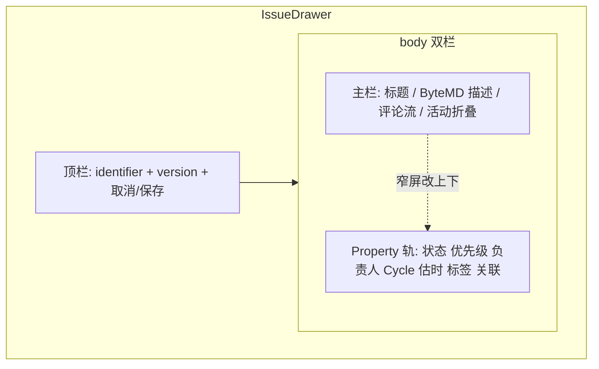

# Issue 详情布局稿（对标 Linear）

> 产品体验助手 · 可执行布局规格  
> 范围：仅布局/信息架构；**不改**业务 `tsx/ts`（本文件为文档交付物）  
> 主入口：`src/components/issue/IssueDrawer.tsx`  
> 关联约定：`BOARD_UI.md`（挂载）、`THEME.md`（token）、`../COORDINATION.md`（UI bar：克制/紧凑/细边框）  
> **冲突说明**：上述文档**未**规定 Issue 详情分区；本文件为首次布局约定。主题 token（主色 `#5E6AD2`、细边框、`controlHeight: 28`）继续遵守 `THEME.md` / `linearTheme.ts`，勿另起一套。

---

## 0. 给总指挥的短报（可直接转发）

**现状一句话**：Issue 抽屉 `width=560`，标题/描述与状态·优先级·负责人·Cycle·估时·标签全部塞进同一条 Ant Design `Form layout="vertical"` 长表，再叠关联/评论/活动，一屏密密麻麻，主内容无居中留白、无 Property 轨；描述为纯 `TextArea`，无 Markdown 预览。

**定稿两句话（本次）**

1. **抽屉**：桌面默认 **`width: 800`**（硬验收 ≥720），**`height: 100%`**（接近 viewport 全高）；窄屏保留 `min(100vw, 560)`。
2. **描述编辑器**：**ByteMD `^1.22`**——中文产品友好、轻量、自带编辑/预览切换；对标 Linear 简洁主舞台，不引入 TipTap/Milkdown 级重量。

**布局原则（正好 5 条）**

1. **主栏居中留白**：大标题（inline edit）+ 描述（Markdown 主舞台）+ 分隔 + 评论流；禁止属性挤进主栏。
2. **属性进紧凑 Property 轨**：状态 / 优先级 / 负责人 / Cycle / 估时 / 标签 / 关联；label 左、value 右，一行一项。
3. **禁止 Ant Form 大栅格**：不得用多列/`Form.Item` 竖排把属性堆成「表单墙」。
4. **对标 Linear**：克制、细边框、紧凑信息密度（继承 `THEME.md` token）。
5. **活动不占满首屏**：并入评论流下方折叠，或独立折叠区默认收起。

**验收（核心）**：打开抽屉一眼不挤——首屏可见大标题+描述留白，属性在右侧/顶下一列 Property 行，无 Form 密栅格；描述可写 Markdown、可预览、中文输入流畅。

---

## 1. 现状问题（对照原则，点名文件）

| # | 问题 | 位置 | 违背原则 |
|---|------|------|----------|
| 1 | 属性与正文同一条垂直 Form 墙 | `IssueDrawer.tsx` L531–594：`Form layout="vertical"` 含 title / status / priority / assignee_id / cycle_id / estimate / label_ids / description | 禁止 Form 大栅格；主内容应居中留白 |
| 2 | 无主栏 / Property 轨分区；抽屉偏窄偏矮 | 整个 `Drawer` body 单列滚动；`width={560}`（L473） | 主栏 vs 属性轨；桌面默认应 ≥720 且接近全高 |
| 3 | 标题是带 label 的 `Form.Item`，非大标题 inline | L532–534 | Linear 式大标题 |
| 4 | 描述夹在属性中间（估时/标签之后）；纯 TextArea | L572–593 | 描述应为主舞台 + Markdown 编辑/预览 |
| 5 | 状态双重入口且占首屏 | 顶栏 `Segmented`「快速状态」L492–503 + Form 内 Select L535–538 | 应收敛到 Property 轨单控件 |
| 6 | 优先级 Tag 条 + Form Select 重复 | L504–527 + L540–546 | 同上 |
| 7 | 关联 / 评论 / 活动连续堆叠 | L596–753，无折叠 | 活动一屏堆满 |
| 8 | 评论输入在 footer，列表在中部 | footer `commentFooter` L438–459 vs 中部评论 List | 评论流应连贯在主栏 |
| 9 | CSS 仍按 Form 调距 | `board.css` `.acb-drawer .ant-form-item` margin 12px | 会强化「表单感」 |
| 10 | 项目无 Markdown 库；Wiki 亦为纯 TextArea | `package.json` 无 MD 依赖 | 描述需选定 MD 编辑器（见 §11） |

**同目录现状**：`src/components/issue/` 仅有 `IssueDrawer.tsx` + `index.ts`，评论/关联/活动/属性均未拆组件。

**文档侧**：`BOARD_UI.md` 只登记导出路径；`THEME.md` / `COORDINATION.md` UI bar 要求对标 Linear，但**无**详情页线框——本文件补齐，不与之冲突。

---

## 2. 目标信息架构

### 2.1 ASCII 线框（桌面默认 width=800 / 接近全高）

```
┌─ Drawer ════════════════════════ width: 800 · height: 100% ══════════════┐
│ [ABC-12]  v3                                    [取消] [保存]           │  ← 顶栏 chrome
├──────────────────────────────────────────────┬──────────────────────────┤
│                                              │  Property 轨 ≈ 260       │
│  主栏 max-width ≈ 480–520，水平居中留白       │  ┌────────────────────┐ │
│                                              │  │ 状态      [进行中 ▾]│ │
│  ┌ 大标题（borderless Input / Typography） ─┐ │  │ 优先级    [高 ▾]   │ │
│  │ 实现 Issue 详情 Linear 布局              │ │  │ 负责人    [👤 阿明]│ │
│  └──────────────────────────────────────────┘ │  │ Cycle     [S12 ▾]  │ │
│                                              │  │ 估时      [3 pt]   │ │
│  ┌ 描述 · ByteMD（tab：编辑 | 预览） ───────┐ │  │ 标签      [bug][fe]│ │
│  │  [B I ` <> ···]              [编辑|预览] │ │  │ 关联      2 项 · + │ │
│  │                                          │ │  └────────────────────┘ │
│  │  （Markdown 主舞台，大块留白）            │ │                          │
│  │  空态：「添加描述…」                      │ │                          │
│  └──────────────────────────────────────────┘ │                          │
│                                              │                          │
│  ── 评论 ──────────────────────────────────  │                          │
│  👤 阿明 · 10:21                             │                          │
│  同意，先拆 Property 轨                       │                          │
│  ┌ 写评论… ⌘Enter ─────────────────────────┐ │                          │
│  └──────────────────────────────────────────┘ │                          │
│                                              │                          │
│  ▸ 活动（默认折叠）                          │                          │
│                                              │                          │
└──────────────────────────────────────────────┴──────────────────────────┘
```

尺寸核算（与加宽一致）：`800 − 260(轨) − 1(分隔) ≈ 539` 主栏可用宽；内容 `max-width: 480–520` 居中 → 左右留白成立。

### 2.2 窄抽屉 / 小屏（&lt; 640 内容宽）

Property 轨改为**顶栏下方横向紧凑条**或**主栏上方一列**（仍一行一项 label|value），**禁止**回到多字段 Form 栅格。抽屉宽：`min(100vw, 560)`；高度仍 `100%`。描述编辑器窄屏保持 `tab`（勿强制 split 挤爆）。



---

## 3. 分区职责

| 分区 | 放什么 | 不放什么 |
|------|--------|----------|
| **顶栏** | `identifier`、次要 `v{version}`、关闭/保存（或改自动保存后仅关闭） | 属性编辑、评论框 |
| **主栏** | 大标题 inline edit、描述 Markdown 主舞台（ByteMD）、分隔线、评论列表 + 输入、活动折叠 | 状态/优先级/负责人/标签/Cycle/估时/关联 |
| **Property 轨** | 上列全部属性 + 关联列表/添加；每行 label 左 value 右 | 标题、描述长文、评论正文 |
| **Footer** | 建议**取消**独立 comment footer；评论输入归主栏评论流底部 | — |

**保存策略建议（布局无关，实现可后续定）**：Property 行变更可继续走现有 `quickStatus` / `quickPriority` 式乐观 PATCH；标题/描述可 blur 保存或保留顶栏「保存」。布局验收不绑定某一种。

---

## 4. 各属性控件形态（紧凑单行，非 Form 栅格）

每一行结构：`[12px 次要色 label 固定宽 ~64–72px] [flex value 控件]`，行高约 28–32px（对齐 `controlHeight: 28`）。

| 属性 | 控件建议 | 交互 |
|------|----------|------|
| 状态 | 紧凑 Select 或带色点的 Dropdown | 即时 PATCH（复用 `quickStatus`） |
| 优先级 | Select / 图标+文案 Dropdown | 即时 PATCH（复用 `quickPriority`） |
| 负责人 | Avatar(小) + 姓名 Select；空态「未指派」 | 即时或 blur PATCH |
| Cycle | Select；空态「未划入」 | 同上 |
| 估时 | 行内数字（可 `InputNumber` bordered=false）+ `pt` 后缀 | 同上 |
| 标签 | 多选 Tag 展示 + 点击弹出多选；色点用 `Label.color` | 同上 |
| 关联 | 轨内摘要「N 项」展开列表；添加用紧凑 type + Issue 搜索，勿大表单 | 现有 relations API |

**明确禁止**

- `Form` + 多个带 label 的 `Form.Item` 竖排充当属性区  
- `Row`/`Col` 多列栅格塞属性  
- 主栏再放一套状态 Segmented「快速状态」墙（可保留键盘快捷，UI 不占首屏）

标题可用受控 Input，**不必**包在属性同一 `Form` 里；描述改 ByteMD，存 Markdown 字符串。若需校验，仅标题保留轻量 required。

---

## 5. 断点 / 宽度 / 高度（硬验收）

| 量 | **定稿数字** | 说明 |
|----|--------------|------|
| Drawer `width`（桌面默认） | **`800`** | **硬验收：≥ 720**；建议区间 760–840，取 800。现状 560 必须改掉 |
| Drawer `height` | **`100%`**（接近 viewport 全高） | Ant Design Drawer 设 `styles={{ body: … }}` / 根样式使内容区吃满；视觉上接近全高，非矮弹层 |
| 窄屏 `width` | **`min(100vw, 560)`** | 保留窄屏策略；高度仍 `100%` |
| 主栏内容 `max-width` | **480–520** | 居中，左右留白（与 800 宽 + 260 轨一致） |
| Property 轨宽度 | **260**（允许 240–280） | 固定宽，不跟主栏抢；加宽后取 260 中值 |
| 主栏↔轨分隔 | `1px solid var(--acb-border)` | 细边框，对标 Linear |
| 双栏启用断点 | 抽屉内容宽 **≥ 640** | 以下改为轨在上/顶下单列 Property 行 |
| 行高 / 控件 | 28–32px | 继承 `linearTheme` |
| 描述区最小可视高 | **≥ 160px**（空态也明显大于单个 Select） | ByteMD 容器高度；工具栏克制 |

**实现提示（给前端，非本文件改代码）**：`Drawer` 的 `width={800}`；高度用 `height: '100%'` 或等价 styles，避免默认「半高抽屉」感。

---

## 6. 组件拆分建议（改哪些、新建哪些）

> 实施时由 @React 前端 / 看板 UI 改代码；本文件只定边界。

| 动作 | 路径 | 职责 |
|------|------|------|
| **重构** | `src/components/issue/IssueDrawer.tsx` | 壳：Drawer chrome、`width=800` / `height=100%`、数据加载、保存/乐观更新编排；body 改为主栏+轨布局 |
| **新建** | `src/components/issue/IssueDetailMain.tsx` | 大标题 + ByteMD 描述 + 评论流（列表+输入）+ 活动折叠入口 |
| **新建** | `src/components/issue/IssueDescriptionEditor.tsx` | ByteMD 封装：`locale=zh_Hans`、`mode="tab"`、占位「添加描述…」、受控 value/onChange |
| **新建** | `src/components/issue/IssuePropertyRail.tsx` | Property 行容器（状态…关联） |
| **新建** | `src/components/issue/IssuePropertyRow.tsx` | 单行 label \| value 布局原语 |
| **新建** | `src/components/issue/IssueCommentList.tsx` | 评论列表 + 删除确认（从 Drawer 抽出） |
| **新建** | `src/components/issue/IssueActivityFold.tsx` | 默认折叠的活动时间线 |
| **新建** | `src/components/issue/IssueRelationsBlock.tsx` | 关联列表 + 添加（挂在轨内） |
| **样式** | `src/components/board/board.css` 或 `issue/issue-detail.css` | `.acb-issue-detail` / `.acb-property-rail` / `.acb-property-row` / `.acb-issue-md`；弱化或删除「整页 form-item」假设；ByteMD 皮肤贴合细边框 |
| **依赖** | `package.json`（实施时由前端加） | 见 §11.4；**本轮文档不改 package.json** |
| **导出** | `src/components/issue/index.ts` | 仍主导出 `IssueDrawer`；子组件可不对外 |
| **文档回链** | `BOARD_UI.md` 指向本文件 | 避免约定漂移 |

**不要**：在 `pages/` 另起详情页 unless 产品改路由；本阶段仍是 Drawer。

---

## 7. 验收标准清单（QA / 前端可勾选）

### 核心（打开抽屉一眼不挤）

- [ ] **A1** 打开任意 Issue 抽屉，首屏第一眼是大标题 + 描述留白区，**不是**一排 Form 标签墙
- [ ] **A2** 状态 / 优先级 / 负责人 / Cycle / 估时 / 标签 / 关联均在 Property 轨（或窄屏顶下一列 Property 行），**主栏不可见**这些字段的 Form.Item
- [ ] **A3** 属性区为「一行一项、label 左 value 右」，无 Ant Design Form 多列栅格
- [ ] **A4** 评论流在主栏描述下方，输入与列表视觉连贯；不再依赖「中部列表 + footer 输入」割裂为首屏噪音
- [ ] **A5** 活动默认折叠（或并入评论下次级区），默认展开时不占满首屏

### 结构与密度

- [ ] **B1** 桌面抽屉 **默认 width = 800**（硬验收 **≥ 720**），**height = 100%**（接近 viewport 全高）；主栏内容 max-width ≤ 520 且视觉居中
- [ ] **B2** Property 轨宽约 **260**（240–280），与主栏有 1px 细分隔；与 800 宽算账后主栏仍有居中留白
- [ ] **B3** 无「快速状态」Segmented 整行墙与轨内状态控件重复占首屏（若保留快捷，不占主视觉）
- [ ] **B4** 标题呈现为大号边框弱化/无边框文本，而非「标题」小 label + 普通 Input
- [ ] **B5** 空描述有克制**中文**占位（如「添加描述…」），描述区高度明显大于单个 Select（≥160px 可视）

### Markdown 描述（§11）

- [ ] **M1** 描述区可输入/保存 Markdown（至少：标题、粗斜体、列表、链接、代码；建议 GFM）
- [ ] **M2** 可预览（`tab` 编辑|预览切换；宽屏可选 split，但默认以 tab 保主舞台简洁）
- [ ] **M3** 中文 / CJK 输入不卡顿（拼音组字、连续输入无掉字）
- [ ] **M4** 工具栏/空态占位为中文（`bytemd/locales/zh_Hans.json` + placeholder）
- [ ] **M5** 未编辑时外观克制：细边框、不高亮成「重型富文本框」；贴合 `THEME.md`

### 回归

- [ ] **C1** 改状态/优先级仍可保存成功（乐观或显式保存），version conflict 提示仍在
- [ ] **C2** 评论发送（含 ⌘/Ctrl+Enter）、删除仍可用
- [ ] **C3** 关联添加/删除仍可用
- [ ] **C4** 看板 / 列表 / Cycle 页打开同一 `IssueDrawer` 行为一致
- [ ] **C5** 浅色默认主题下边框/主色仍符合 `THEME.md`（`#5E6AD2`、细边框）
- [ ] **C6** 窄屏策略仍可用：`min(100vw, 560)`，Property 改上下/顶条，描述保持 tab

---

## 8. 给总指挥的三行原则摘要

1. **主栏只谈事**：大标题 + Markdown 描述留白 + 评论；属性全部离开主栏。  
2. **属性只排轨**：右侧（或顶下一列）Property 行，一行一项，禁 Form 栅格墙。  
3. **首屏要透气**：抽屉 800×全高；活动折叠；ByteMD 轻量预览——打开抽屉一眼不挤。

---

## 9. 同步建议

| 角色 | 建议 | 原因 |
|------|------|------|
| **@UI 视觉** | **立刻同步** | 需出 Property 行 / 主栏留白 / 分隔线 / ByteMD 皮肤的具体间距与控件态（hover、空态、编辑|预览切换），并确认与 `THEME.md` token 一致；抽屉 800×全高线框 |
| **@React 前端**（看板 UI） | **立刻同步** | 唯一实现方；`IssueDrawer.tsx` 需按 §6 拆分 + 接入 ByteMD（§11），属破坏性 UI 重构 |

实施顺序建议：UI 视觉确认 §2–§5、§11 无异议（可标「按本文默认值开工」）→ React 按 §6 + §11 拆组件与加依赖 → QA 跑 §7。

### 9.1 落地要点（转发用）

**给 @UI 视觉（3）**

1. 按 **800 宽 × 100% 高** 出桌面线框：主栏内容 480–520 居中 + 右轨 **260** + 1px 分隔；窄屏轨改顶下。
2. 描述主舞台按 **ByteMD tab（编辑|预览）** 出态：空态中文占位、克制工具栏、细边框；勿做成重型 Notion 块编辑器。
3. Property 行 28–32 高、label 次要色 ~64–72 宽；与加宽后的主栏留白同一套间距节奏。

**给 @React 前端（3）**

1. `Drawer`：`width={800}`，`height: '100%'`（或等价 styles）；内容宽 &lt;640 时退回轨在上/`min(100vw,560)`。
2. 拆出 `IssueDescriptionEditor`：`bytemd` + `@bytemd/react` + `@bytemd/plugin-gfm`，`locale=zh_Hans`，`mode="tab"`，value 为 Markdown 字符串。
3. 属性全部迁入 `IssuePropertyRail`；主栏禁止 Form 属性墙；存储层描述字段继续字符串即可（Markdown 原文）。

---

## 10. 修订记录

| 日期 | 说明 |
|------|------|
| 2026-10-24 | 初稿：审计 `IssueDrawer.tsx` 现状，产出对标 Linear 布局稿 + 短报 + 验收清单 |
| 2026-10-24 | **定稿**：抽屉默认 **800 × 100%**（硬验收 width≥720）；选定 **ByteMD ^1.22** 作描述编辑器；增补 §11 选型与 M1–M5 验收；主栏/轨尺寸与 800 宽对齐 |

---

## 11. Markdown 编辑器选型（定稿：ByteMD）

### 11.1 候选对比（调研摘要）

| 维度 | **ByteMD** | TipTap | Milkdown |
|------|------------|--------|----------|
| 定位 | Markdown 源码编辑 + 预览（CodeMirror） | 富文本 / ProseMirror；MD 为扩展 | Markdown-first ProseMirror（WYSIWYG） |
| 预览形态 | 内置 `split` / `tab` / `auto` | 所见即所得；MD 导入导出需 `@tiptap/markdown`（早期） | WYSIWYG；源码视图靠插件 |
| 包体积（量级） | ~150KB gzip 实用集 | 核心小但扩展栈厚；完整 MD 方案更重 | ~105KB 最小集，Crepe/主题/插件后上行 |
| 中文 / CJK | **官方 `zh_Hans` locale**；字节系中文产品血统；占位/工具栏可本地化 | 无官方中文工具栏包，需自建 UI 文案 | 文档/社区强，CJK 强调语法常需额外 remark 插件 |
| 维护 / 生态 | v1.22.0（2025-02）；peer `react: *`；插件化 | 极活跃（React 19 官方支持）；部分能力 Pro 付费 | 活跃；headless，可用 UI 需自己拼或 Crepe |
| 与本栈契合 | React 封装薄、Vite 友好、依赖少 | 与 Ant Design 可共存但偏「重编辑器」 | 与 AntD 可共存，集成曲线陡 |
| 对标 Linear 简洁主舞台 | **最贴**：轻量、编辑/预览、不过度富文本化 | 过重，易滑向块编辑器 | 中等偏重；Markdown-first 好，但搭建成本高 |

**项目约束**：`package.json` 当前**无**任何 MD 库；Wiki 亦为纯 TextArea；Issue 描述现为 Form TextArea。技术栈：React 19 + Ant Design 6 + Vite 6 + pnpm。

### 11.2 选定结论

**选定：ByteMD（`bytemd` / `@bytemd/react`）版本范围建议：`^1.22.0`。**

**为何选它（相对另两者）**

1. **轻量 + 形态匹配**：Issue 描述对标 Linear 简洁主舞台，需要「能写 MD + 能预览」，不要 TipTap 级富文本扩展面；ByteMD 默认就是编辑/预览，体积可控。
2. **中文友好开箱**：`bytemd/locales/zh_Hans.json` 覆盖工具栏等文案；占位用中文字符串即可；CJK 输入走 CodeMirror 路径，实践中拼音组字稳定，无需先堆 CJK 插件才能用。
3. **接入成本最低**：`@bytemd/react` 的 `Editor` 受控组件 + 可选 `@bytemd/plugin-gfm` 即可交付；与 Ant Design Drawer / React 19 / Vite 无架构冲突。TipTap 要拼 StarterKit + Markdown 扩展 + 自绘工具栏；Milkdown 要拼 core/preset/theme（或 Crepe），均重于本场景。

**不选 TipTap 的理由（一句）**：强扩展富文本首选，但 Markdown round-trip 非其主路径且方案偏重，偏离「描述主舞台简洁」目标。  
**不选 Milkdown 的理由（一句）**：Markdown-first WYSIWYG 优秀，但对 Issue 描述过重、集成与 CJK 打磨成本高于 ByteMD 的 tab 预览方案。

### 11.3 推荐集成形态（Issue 描述主舞台）

- **默认模式：`mode="tab"`**（编辑 | 预览切换）——主栏单栏透气，对标 Linear 简洁，避免 split 双栏挤占居中留白。
- 可选：抽屉内容很宽且产品希望对照预览时，再开 `mode="split"` 或 `auto`；**验收以 tab 为准**。
- 只读展示（若未来有）可用同库 `Viewer`。
- 值类型：**Markdown 字符串**（与现 TextArea 字段兼容，便于渐进替换）。

### 11.4 最小依赖列表（包名）

实施时由前端安装（**本轮不改 package.json**）：

| 包名 | 用途 |
|------|------|
| `bytemd` | 核心编辑器 + CSS + `locales/zh_Hans.json` |
| `@bytemd/react` | React `Editor` / `Viewer` |
| `@bytemd/plugin-gfm` | GFM（表格、删除线、任务列表等） |

样式：`import 'bytemd/dist/index.css'`，再用 `.acb-issue-md` 覆盖边框/圆角贴合主题。  
**不要**首批就装 mermaid/math/highlight 全家桶，避免抽屉变重。

### 11.5 Wiki 后续

Wiki 建议**后续同库（ByteMD）**统一体验与依赖；本阶段仅 Issue 描述接入即可。

### 11.6 描述区验收（摘要）

描述区能写 Markdown、能预览、中文输入不卡、空态中文占位——详见 §7 **M1–M5**。
